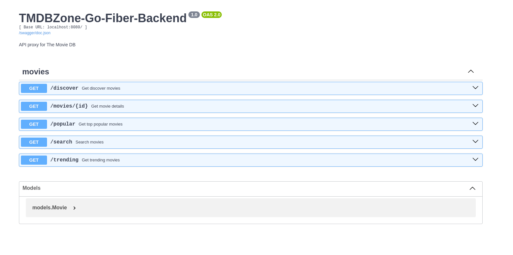

# TMDBVerse Go Fiber Redis Backend

API REST desarrollada por **Alexis Manuel Hurtado Garcia** que actúa como proxy de [The Movie Database (TMDB)](https://www.themoviedb.org/). Construida con **Go** y **Fiber**, cachea las respuestas en **Redis**, protege las llamadas externas con un *circuit breaker* y calcula las películas en tendencia a partir de las búsquedas de los usuarios. Es el backend del proyecto TMDBVerse; el frontend está en [TMDBVerse-React-TailwindCSS-Frontend](https://github.com/A4GOD-AMHG/TMDBVerse-React-TailwindCSS-Frontend).

## Tech Stack

<div style="display: flex; align-items: center;">
  
  
  
  
</div>

## Características

- **Proxy de TMDB**: películas populares, descubrimiento, búsqueda y detalles sin exponer el token de TMDB al cliente.
- **Caché con Redis**: respuestas cacheadas por ruta y por consulta para reducir llamadas a la API externa.
- **Tendencias**: las búsquedas se registran en un *sorted set* de Redis para obtener el top 5 de películas más buscadas.
- **Circuit breaker**: `gobreaker` corta las llamadas a TMDB cuando falla de forma continuada (responde `503`).
- **Errores JSON consistentes**: todas las respuestas de error tienen la forma `{ "error": "mensaje" }` con el código HTTP adecuado (`400`, `404`, `502`, `503`).
- **Documentación Swagger** interactiva en `/swagger/index.html`.
- **Docker Compose**: levanta la API y Redis con un solo comando.

## Dependencias

### Dependencias Principales

- `github.com/gofiber/fiber/v2`: framework HTTP (incluye los middlewares de CORS, logger y recover).
- `github.com/go-redis/redis/v8`: cliente de Redis para la caché y las tendencias.
- `github.com/sony/gobreaker`: circuit breaker para las llamadas a TMDB.
- `github.com/gofiber/swagger`: sirve la interfaz de Swagger UI.
- `github.com/swaggo/swag`: genera la especificación OpenAPI a partir de las anotaciones.

### Dependencias de Desarrollo

- `swag` (CLI): regenerar la documentación con `swag init -g cmd/main.go`.

## Cómo usar

1. **Clona el repositorio**:

```bash
git clone https://github.com/A4GOD-AMHG/TMDBVerse-Go-Fiber-Redis-Backend.git
cd TMDBVerse-Go-Fiber-Redis-Backend
```

2. **Configura las variables de entorno** copiando `example.env` a `.env`:

```bash
cp example.env .env
```

| Variable | Descripción | Por defecto |
|----------|-------------|-------------|
| `TMDB_API_ACCESS_TOKEN` | Token de lectura (v4) de la API de TMDB. **Obligatorio** | — |
| `REDIS_URL` | `redis://host:puerto/db` o `host:puerto` | `localhost:6379` |
| `PORT` | Puerto HTTP de la API | `8080` |

3. **Ejecuta en local** (necesitas Go 1.25+ y un Redis en marcha):

```bash
go mod tidy
export $(cat .env | xargs)
go run ./cmd/main.go
```

4. **O con Docker Compose** (levanta también Redis):

```bash
docker compose up --build
```

La API queda en `http://localhost:8080` y Swagger en `http://localhost:8080/swagger/index.html`.

## API

| Método | Ruta | Parámetros | Descripción | Caché |
|--------|------|------------|-------------|-------|
| `GET` | `/discover` | `page` (1-500, opcional) | Películas ordenadas por popularidad | 10 min |
| `GET` | `/popular` | — | Las 3 películas más populares | 30 min |
| `GET` | `/search` | `q` (obligatorio), `page` (opcional) | Búsqueda por título; registra la búsqueda para tendencias | 1 h |
| `GET` | `/trending` | — | Top 5 de películas más buscadas (incluye `search_count`) | — |
| `GET` | `/movies/{id}` | `id` (path) | Detalles de una película (`genres`, `runtime`, `backdrop_path`...) | 30 min |
| `GET` | `/swagger/*` | — | Documentación Swagger | — |

Errores: `{ "error": "mensaje" }` con `400` (parámetros inválidos), `404` (película no encontrada), `502` (fallo de TMDB) o `503` (circuit breaker abierto).

## Estructura del Proyecto

```
TMDBVerse-Go-Fiber-Redis-Backend/
├── cmd/
│   └── main.go                  # Arranque: config, Redis, middlewares y rutas
├── docs/                        # Especificación Swagger generada (docs.go, swagger.json, swagger.yaml)
├── internal/
│   ├── config/
│   │   └── config.go            # Lectura de variables de entorno
│   ├── handlers/
│   │   ├── cache_middleware.go  # Middleware de caché por URL en Redis
│   │   ├── errors.go            # Respuestas de error JSON y validación de parámetros
│   │   └── movie_handler.go     # Handlers HTTP de películas
│   ├── models/
│   │   └── models.go            # Movie, Genre, ErrorResponse
│   └── services/
│       ├── cache.go             # Get/Set sobre Redis
│       ├── circuit_breaker.go   # Configuración de gobreaker
│       ├── errors.go            # Error de estado de TMDB
│       └── movie_service.go     # Llamadas a TMDB, caché y tendencias
├── screenshots/
│   └── swagger.png
├── docker-compose.yml
├── Dockerfile
├── example.env
└── go.mod
```

## Capturas de Pantalla

<div align="center" style="display: flex; flex-wrap: wrap; justify-content: center;">
  
</div>

## Licencia

Este proyecto es de código abierto y está disponible para uso personal y educativo.

## Autor

**Alexis Manuel Hurtado Garcia** - [GitHub](https://github.com/A4GOD-AMHG)
